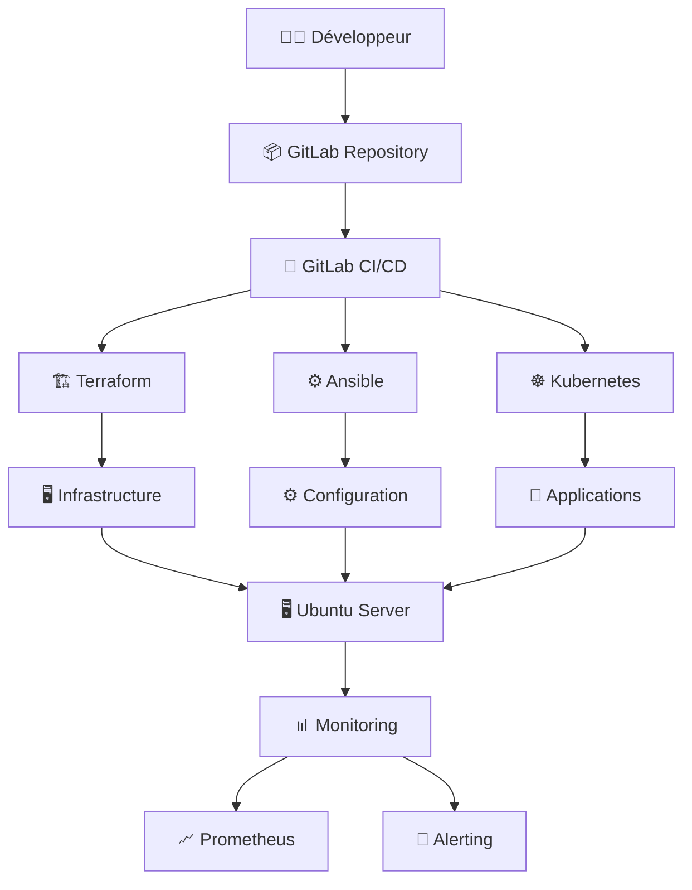
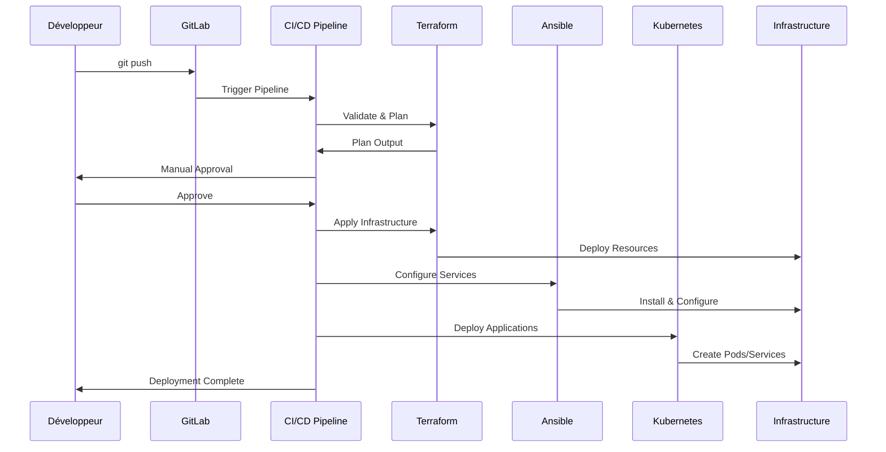
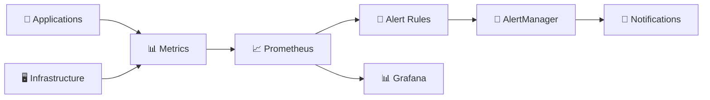

# 🏗️ Architecture Infrastructure as Code

## Vue d'ensemble

Architecture complète de l'infrastructure HomeLab automatisée utilisant les principes Infrastructure as Code (IaC) avec GitLab CI/CD, Terraform, Ansible et Kubernetes.

## 🎯 Principes Architecturaux

### Infrastructure as Code

- **Déclaratif** : Configuration exprimée en code versionné
- **Reproductible** : Déploiements identiques entre environnements
- **Auditable** : Historique complet des changements
- **Scalable** : Architecture modulaire et extensible

### GitOps

- **Source de vérité** : Repository Git central
- **Automatisation** : Déploiements via pipelines CI/CD
- **Validation** : Tests automatisés avant déploiement
- **Rollback** : Restauration rapide en cas de problème

## 🏛️ Architecture Globale



## 📊 Composants Principaux

### 1. GitLab CI/CD (Orchestration)

```yaml
Stages:
  - validate    # Validation syntaxique
  - plan        # Planification changements
  - apply       # Application infrastructure
  - kubernetes  # Configuration K8s
  - deploy      # Déploiement applications
  - sync        # Synchronisation externe
  - cleanup     # Nettoyage ressources
```

### 2. Terraform (Infrastructure)

```hcl
Modules:
  ├── globals/          # Variables centralisées
  └── environments/
      ├── dev/          # Configuration développement
      └── prod/         # Configuration production
```

### 3. Ansible (Configuration)

```yaml
Structure:
  ├── inventory/        # Inventaires dynamiques
  ├── playbooks/        # Playbooks de configuration
  └── roles/            # Rôles réutilisables
```

### 4. Kubernetes (Orchestration)

```yaml
Namespaces:
  ├── automation        # Outils d'automatisation
  ├── databases         # Bases de données
  ├── cache             # Services de cache
  └── monitoring        # Observabilité
```

## 🌐 Architecture Réseau

### Topologie Réseau

```text
┌─────────────────────────────────────────┐
│           Réseau Privé 192.168.1.0/24  │
├─────────────────────────────────────────┤
│  Gateway: 192.168.1.1                  │
│  DNS: 192.168.1.1, 8.8.8.8            │
│                                         │
│  ┌─────────────┐  ┌─────────────┐      │
│  │ Dev Server  │  │ Prod Server │      │
│  │ 192.168.1.63│  │ 192.168.1.64│      │
│  └─────────────┘  └─────────────┘      │
└─────────────────────────────────────────┘
```

### Sécurité Réseau

- **Isolation** : Network Policies Kubernetes
- **Chiffrement** : TLS pour communications internes
- **Accès** : SSH avec clés, pas de password
- **Firewall** : iptables/ufw configuré automatiquement

## 🏢 Environnements

### Développement (Dev)

```yaml
Serveur: 192.168.1.63
Objectif: Tests et développement
Configuration:
  - Quotas relaxés
  - Monitoring basique
  - Sauvegardes hebdomadaires
  - Network Policies permissives
```

### Production (Prod)

```yaml
Serveur: 192.168.1.64
Objectif: Services critiques
Configuration:
  - Quotas stricts
  - Monitoring complet
  - Sauvegardes quotidiennes
  - Network Policies restrictives
  - Haute disponibilité
```

## 🔄 Flux de Déploiement

### Workflow Standard



### Validation Multi-Niveaux

1. **Syntaxique** : Validation Terraform/Ansible/YAML
2. **Logique** : Cohérence des variables et références
3. **Sécurité** : Scan des configurations sensibles
4. **Fonctionnelle** : Tests de connectivité et services

## 📦 Architecture des Données

### State Management

```yaml
Terraform State:
  - Local backend (pour HomeLab)
  - Sauvegarde automatique
  - Verrouillage des opérations
  - Historique des changements

Kubernetes State:
  - etcd intégré K3s
  - Snapshots automatiques
  - Restauration point-in-time
```

### Stockage

```yaml
Storage Classes:
  - local-path: Stockage standard K3s
  - local-ssd-fast: Haute performance
  - local-standard: Usage général
  - local-backup: Sauvegardes
```

### Monitoring Data

```yaml
Prometheus:
  - Rétention: 30j (prod), 7j (dev)
  - Métriques: Infrastructure + Applications
  - Alerting: Règles prédéfinies
  - Storage: SSD dédié
```

## 🔐 Architecture Sécurité

### Niveaux de Sécurité

```yaml
Infrastructure:
  - SSH Key-based authentication
  - Firewall automatisé
  - Updates automatiques sécurité

Kubernetes:
  - RBAC configuré par namespace
  - Network Policies restrictives
  - Pod Security Standards
  - Service Accounts dédiés

GitLab:
  - Variables chiffrées
  - Runners isolés
  - Branches protégées
  - Approbations manuelles
```

### Gestion des Secrets

```yaml
Terraform: Variables GitLab CI/CD
Ansible: Vault (futur)
Kubernetes: Secrets API
Applications: External Secrets (futur)
```

## 📈 Monitoring & Observabilité

### Architecture Monitoring



### Métriques Collectées

- **Infrastructure** : CPU, RAM, Disk, Network
- **Kubernetes** : Pods, Services, Namespaces
- **Applications** : Custom metrics via annotations
- **GitLab** : Pipeline metrics, Runner status

## 🚀 Évolutivité

### Extensibilité Horizontale

- **Ajout nodes** : Configuration K3s multi-nodes
- **Load balancing** : Ingress controllers
- **Auto-scaling** : HPA/VPA Kubernetes

### Extensibilité Verticale

- **Resources** : Quotas Kubernetes ajustables
- **Storage** : Expansion volumes automatique
- **Compute** : Allocation CPU/RAM dynamique

## 📚 Documentation Architecture

### 🔍 Guides Détaillés

- [**Overview**](overview.md) - Vue technique détaillée
- [**Environments**](environments.md) - Configuration environnements
- [**Security Model**](security-model.md) - Modèle de sécurité
- [**Infrastructure Diagram**](infrastructure-diagram.md) - Schémas détaillés

### 🛠️ Guides Opérationnels

- [**Terraform Guide**](../guides/terraform/README.md)
- [**Ansible Guide**](../guides/ansible/README.md)
- [**Kubernetes Guide**](../guides/kubernetes/README.md)
- [**Monitoring Guide**](../guides/monitoring/README.md)

## 🎯 Prochaines Évolutions

### Court Terme (1-3 mois)

- **Grafana** : Dashboards visuels
- **AlertManager** : Notifications avancées
- **External Secrets** : Gestion secrets centralisée
- **Backup** : Stratégie sauvegarde automatisée

### Moyen Terme (3-6 mois)

- **Multi-node K3s** : Haute disponibilité
- **Service Mesh** : Istio/Linkerd
- **GitOps Apps** : ArgoCD/FluxCD
- **Chaos Engineering** : Tests de résilience

### Long Terme (6+ mois)

- **Hybrid Cloud** : Intégration cloud public
- **Compliance** : SOC 2, ISO 27001
- **AI/ML** : Plateformes de ML
- **Edge Computing** : Déploiements edge

---

**Besoin de détails ?** 👉 [Overview Technique](overview.md)
